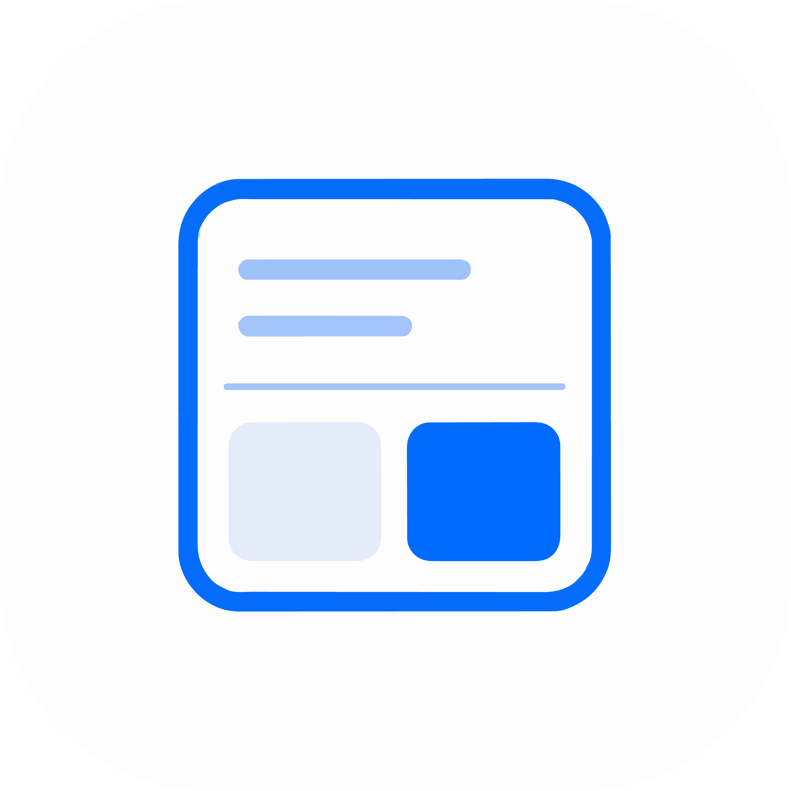

# GXNU Class Tool

<a id="readme-top"></a>

[![Flutter][flutter-shield]][flutter-url]
[![Dart][dart-shield]][dart-url]
[![GetX][getx-shield]][getx-url]

<br />
<div align="center">
  

  <h3 align="center">GXNU Class Tool</h3>

  <p align="center">
    一个面向广西师范大学的 Flutter 课程表应用。
    <br />
    聚焦统一身份认证登录、课表同步、Material Design 体验，以及轻量稳定的移动端使用体验。
  </p>
</div>

## Table of Contents

- [About The Project](#about-the-project)
- [Built With](#built-with)
- [Features](#features)
- [Project Structure](#project-structure)
- [Getting Started](#getting-started)
- [Build Release](#build-release)
- [Notes](#notes)
- [Roadmap](#roadmap)

## About The Project

GXNU Class Tool 是一个基于 Flutter 开发的广西师范大学课程表工具，当前仓库主要面向 Android 与 Windows 环境使用。

项目目前重点包括：

- 基于统一身份认证的登录与登录状态恢复
- 学期、周目切换与实时课表同步
- 首页今日课程概览与课表详情查看
- Material Design 3 风格的移动端界面
- 本地登录信息保存、离线兜底与基础性能优化

<p align="right">(<a href="#readme-top">back to top</a>)</p>

## Built With

- [Flutter](https://flutter.dev/)
- [Dart](https://dart.dev/)
- [GetX](https://pub.dev/packages/get)
- [Dio](https://pub.dev/packages/dio)
- [Hive](https://pub.dev/packages/hive)
- [easy_refresh](https://pub.dev/packages/easy_refresh)
- [connectivity_plus](https://pub.dev/packages/connectivity_plus)
- [flutter_secure_storage](https://pub.dev/packages/flutter_secure_storage)
- [package_info_plus](https://pub.dev/packages/package_info_plus)

<p align="right">(<a href="#readme-top">back to top</a>)</p>

## Features

- 统一身份认证登录，支持记住登录状态
- 启动页自动检查网络与同步登录状态
- 首页显示当前学期、当前周与今日课程安排
- 课表页支持切换学期、切换周目、手动刷新与课程详情抽屉
- 设置页支持主题模式切换、关于页面与退出登录
- 首屏骨架屏、控制器生命周期收敛、按需初始化等基础性能优化
- Android 自适应启动图标与 Material 3 风格主题

<p align="right">(<a href="#readme-top">back to top</a>)</p>

## Project Structure

```text
lib/
├── data/       # API、认证存储、模型、仓储层
├── pages/      # 登录、首页、课表、设置、启动页等页面
├── utils/      # 网络、日志、存储、对话框等工具
├── widgets/    # 通用组件、底部抽屉、骨架动画等
├── class_tool_app.dart
└── main.dart
```

<p align="right">(<a href="#readme-top">back to top</a>)</p>

## Getting Started

### Prerequisites

- Flutter stable SDK
- Dart SDK bundled with Flutter
- Android Studio、VS Code 或其他 Flutter IDE

检查本地环境：

```sh
flutter doctor
```

### Installation

1. 克隆仓库。

   ```sh
   git clone github.com/cubevlmu/GXNUTool.git
   cd class_tool
   ```

2. 安装依赖。

   ```sh
   flutter pub get
   ```

3. 如需重新生成应用图标，可执行：

   ```sh
   dart run flutter_launcher_icons
   ```

### Run

```sh
flutter run
```

示例：

```sh
flutter run -d android
flutter run -d windows
```

<p align="right">(<a href="#readme-top">back to top</a>)</p>

## Build Release

### Android

```sh
flutter build appbundle --release --obfuscate --split-debug-info=./symbols --tree-shake-icons
flutter build apk --release --target-platform android-arm64 --obfuscate --split-debug-info=./symbols --tree-shake-icons
```

### Windows

```sh
flutter build windows --release --obfuscate --split-debug-info=./symbols --tree-shake-icons
```

<p align="right">(<a href="#readme-top">back to top</a>)</p>

## Notes

- 当前项目依赖学校相关系统接口，接口结构或登录策略变化可能导致登录失效。
- 当触发验证码、异地登录校验或登录失败次数过多时，可能需要重新人工登录。
- 应用会在本地保存必要登录信息以支持自动登录，不会在本仓库中实现远端账户托管。
- 建议在真机 `release` 模式下验证启动速度、滚动表现和课表加载体验。
- 仓库当前未包含单独的许可证文件，如需开源发布建议后续补充。

<p align="right">(<a href="#readme-top">back to top</a>)</p>

## Roadmap

- [x] 统一身份认证登录与登录状态恢复
- [x] 首页、课表页、设置页基础功能
- [x] Material Design 3 风格主题与深浅色模式
- [x] 课程详情抽屉与周目、学期切换
- [x] 首页骨架屏与部分启动性能优化
- [ ] 更完整的 README 与模块文档
- [ ] 更完善的异常态与错误提示
- [ ] 更多性能分析与设备侧验证
- [ ] 后续扩展更多校园相关功能

<p align="right">(<a href="#readme-top">back to top</a>)</p>

[flutter-shield]: https://img.shields.io/badge/Flutter-3.x-02569B?style=for-the-badge&logo=flutter&logoColor=white
[flutter-url]: https://flutter.dev/
[dart-shield]: https://img.shields.io/badge/Dart-3.x-0175C2?style=for-the-badge&logo=dart&logoColor=white
[dart-url]: https://dart.dev/
[getx-shield]: https://img.shields.io/badge/GetX-State%20Management-8A2BE2?style=for-the-badge
[getx-url]: https://pub.dev/packages/get
